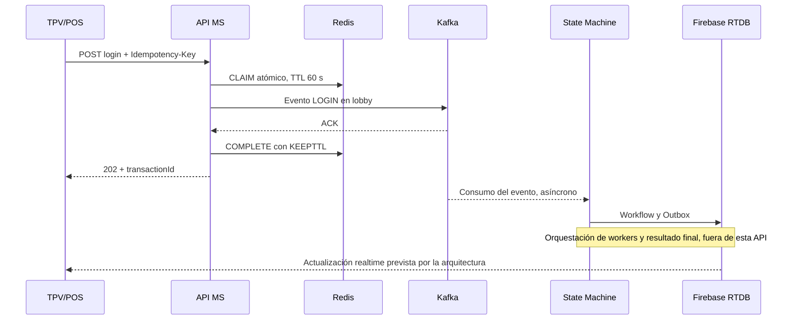

# LeenusTechs CIA — API MS

API de ingesta del sistema CIA para transacciones originadas desde TPV/POS.
Recibe solicitudes HTTP, aplica idempotencia temporal en Redis y publica el
primer evento del workflow en Kafka. Responde **202 Accepted después del ACK de
Kafka**, sin esperar la ejecución del workflow completo.

Este README sigue la organización y terminología de **CIA DeepWiki**: visión
general, API MS, State Machine, idempotencia Redis, contratos, riesgos y operación.
Describe la implementación de este repositorio; los componentes externos se
presentan como contexto de la arquitectura descrita en la wiki.

## Índice

- [Visión general](#visión-general)
- [API MS y componentes internos](#api-ms-y-componentes-internos)
- [Contrato HTTP y mensajes Kafka](#contrato-http-y-mensajes-kafka)
- [Idempotencia temporal en Redis](#idempotencia-temporal-en-redis)
- [Riesgos y garantías](#riesgos-y-garantías)
- [Configuración y operación](#configuración-y-operación)
- [Pruebas y validación](#pruebas-y-validación)

## Visión general

| Capa | Componentes | Responsabilidad |
| --- | --- | --- |
| Edge y cliente | TPV/POS, WAF, Kong, ELB | Acceso HTTP, seguridad perimetral y balanceo, según la arquitectura de la wiki. |
| Ingesta — este repositorio | `leenustechs-cia-api` | Validación del payload, idempotencia Redis, publicación al lobby y respuesta HTTP. |
| Orquestación — repositorio externo | `leenustechs-cia-state` | Workflow multi-etapa, estado durable en Firebase RTDB y Transactional Outbox, según DeepWiki. |
| Ejecución y notificación — componentes externos | Workers MS, Kafka y Firebase RTDB | Procesamiento de etapas y actualización del cliente en tiempo real. |

Flujo de login descrito en la wiki:



La API no configura Firebase, ejecuta etapas de workers ni implementa el Outbox.
La creación de `/workflows/{transactionId}` y la notificación final pertenecen
al flujo externo descrito por la wiki y requieren validación de integración.

## API MS y componentes internos

| Componente | Responsabilidad |
| --- | --- |
| `ApiInterceptor` | Genera un UUID local a la petición y mide su duración. |
| `ConfigApi` | Expone `POST /config-api/v1/activation/login`. |
| `ConfigApiProcessor` | Lee `Idempotency-Key` y delega en `IdempotencyService`. |
| `IdempotencyService` | Ejecuta CLAIM, replay y COMPLETE; genera el `transactionId` estable durante la ventana. |
| `CommonModelMapper` | Construye el evento con `producer=CIA_API` y `command=LOGIN`. |
| `CommandDispatcherServiceImpl` | Enruta la operación al caso de uso. |
| `CommonEventUseCase` | Valida el payload, solicita la publicación y construye una copia para la respuesta. |
| `KafkaProducerAdapter` | Publica el evento y espera la confirmación de Kafka. |
| `GlobalExceptionHandler` | Traduce los errores controlados al contrato HTTP. |

El UUID inicial del interceptor identifica la petición HTTP. El identificador
que devuelve una operación aceptada se genera al ganar el CLAIM y se reutiliza
al reproducir la respuesta cacheada. El `transactionId` enviado en el cuerpo de
entrada no determina la idempotencia.

Código principal: [endpoint HTTP](src/main/java/mx/com/leenustechs/ciaApi/rest/ConfigApi.java),
[servicio de idempotencia](src/main/java/mx/com/leenustechs/ciaApi/business/services/IdempotencyService.java)
y [configuración Kafka](src/main/java/mx/com/leenustechs/ciaApi/config/KafkaConfig.java).

## Contrato HTTP y mensajes Kafka

### Solicitud y respuesta

```http
POST /config-api/v1/activation/login
Content-Type: application/json
Idempotency-Key: 0df6be21-20d4-42e7-87d7-d0ce5033de72

{
  "payload": {
    "terminalId": "tpv-demo"
  }
}
```

`Idempotency-Key` es obligatorio: entre 1 y 128 caracteres ASCII de letras,
dígitos, `.`, `_`, `:` o `-`. Se recomienda un UUID aleatorio por operación
lógica, reutilizado con el mismo payload en los reintentos.

`payload` debe ser un objeto JSON; no se aceptan valores ausentes, nulos,
arrays ni escalares. La API valida esa forma, no un esquema de negocio de login.

Respuesta de ejemplo, con HTTP **202**:

```json
{
  "transactionId": "d43ccdb3-bbbd-40e2-9825-15fba80d0c4a",
  "producer": "CIA_API",
  "command": "LOGIN",
  "payload": {
    "terminalId": "tpv-demo",
    "status": "success"
  }
}
```

`status: success` se añade a una copia del payload de respuesta. El evento Kafka
conserva el payload original. **202 confirma el ACK de Kafka, no el login de
negocio, la creación del workflow en Firebase ni su resultado final.**

### Evento inicial Kafka

La API publica en `leenustechs-cia-lobby` un envelope con `transactionId`,
`producer`, `command` y `payload`. Usa `transactionId` como clave del mensaje y
el header `origin-service` con el nombre de la aplicación.

Los campos `eventId`, `executionId`, `stageIndex`, `outcome` y el header
`event-id` del contrato ampliado de DeepWiki corresponden al flujo downstream;
esta API no los añade al evento inicial. Los topics de workers,
`leenustechs-cia-response` y `leenustechs-cia-response-final` pertenecen a esa
orquestación externa.

### Errores controlados

| HTTP | Código | Condición |
| --- | --- | --- |
| 400 | `INVALID_IDEMPOTENCY_KEY` | Clave ausente o con formato inválido. |
| 400 | `INVALID_PAYLOAD` | El payload no es un objeto JSON. |
| 409 | `IDEMPOTENCY_KEY_CONFLICT` | Clave existente con otro payload. |
| 409 | `IDEMPOTENCY_IN_PROGRESS` | La operación de esa clave sigue pendiente. |
| 503 | `KAFKA_PUBLICATION_UNCONFIRMED` | Fallo, interrupción o entrega incierta. |
| 503 | `IDEMPOTENCY_STORE_UNAVAILABLE` | Redis no permite completar la operación requerida. |
| 500 | `EMPTY_OPERATION_RESPONSE` | Un caso de uso devuelve una respuesta nula. |

Los errores controlados incluyen `transactionId`, `code`, `message` y
`timestamp`. El identificador puede ser nulo si aún no se adquirió una clave.
Los errores de parseo HTTP/JSON también pueden producir 400 con el formato de
error del framework.

## Idempotencia temporal en Redis

Implementación: `StringRedisTemplate` y scripts Lua. Clave:

```text
cia-api:idempotency:login:<Idempotency-Key>
```

| Estado | Significado |
| --- | --- |
| Ausente | Una petición puede ganar el CLAIM. |
| `IN_PROGRESS` | Una petición adquirió la clave antes de publicar. |
| `COMPLETED` | Se confirmó Kafka y se guardó la respuesta. |
| `UNCONFIRMED` | La publicación falló o su entrega es incierta. |
| Expirado | La entrada desaparece y vuelve a poder adquirirse. |

CLAIM consulta y adquiere la clave atómicamente con `SET PX 60000`. La entrada
guarda `transactionId`, `state`, `payload` y, en caso de éxito, `response`.
COMPLETE compara el valor pendiente exacto antes de escribir con `KEEPTTL`.
Una petición antigua no puede sobrescribir una entrada nueva ni recrear la
suya después de expirar.

El TTL es **fijo: 60 segundos desde el primer CLAIM**. Los reintentos, el ACK y
los cambios de estado no lo renuevan. Mientras la entrada exista, el mismo
payload con estado `COMPLETED` reproduce el 202 y el cuerpo originales sin
publicar. Un orden distinto de propiedades JSON no cambia la identidad del
payload. Los demás estados y conflictos siguen la tabla de errores anterior.

**Al expirar, la misma clave puede publicar otro evento**, aunque la petición
anterior siga en curso o su entrega fuera incierta. Redis debe ser compartido
por todas las réplicas, tener capacidad suficiente y usar `noeviction`.

## Riesgos y garantías

| Situación | Alcance real |
| --- | --- |
| TTL de 60 s frente a espera del ACK de hasta 35 s | La ventana cubre la espera configurada del ACK y el posible bloqueo de `send()` de hasta 5 s; después del TTL, un reintento puede publicar nuevamente. |
| COMPLETE devuelve `0` por expiración o cambio de propietario | `save()` no inspecciona ese retorno; puede responder 202 tras ACK sin haber cacheado la respuesta. |
| Claves sin aislamiento por tenant/TPV | El prefijo es global para login; reutilizar una clave entre clientes puede causar conflictos o replay de una respuesta con el mismo payload. |
| Redis falla antes de adquirir la clave | La API devuelve 503 sin publicar. |
| Redis falla después del envío Kafka | Puede devolverse 503 aunque el evento haya llegado. |
| Expiración, expulsión o pérdida de datos Redis | Se pierde la protección y un reintento puede publicar nuevamente. |
| ACK Kafka | Confirma la publicación según `acks=all`; no la ejecución del workflow ni su procesamiento exactamente una vez. |

La deduplicación HTTP está limitada a la ventana y a la disponibilidad de la
entrada Redis. No existe una transacción atómica Redis/Kafka ni una garantía
global de exactly-once. Las garantías de Outbox, reconciliación de etapas y
estado durable descritas en DeepWiki corresponden al State Machine externo.

## Configuración y operación

### Requisitos

| Componente | Requisito |
| --- | --- |
| Java | JDK 21. |
| Maven | **3.9.16 o superior, menor que 4**, según el enforcer de `pom.xml`. |
| Spring | Boot 4.0.9 y Cloud 2025.1.1; verificador de compatibilidad habilitado. |
| Redis | 6+, compartido entre réplicas, `noeviction` y permisos Lua/lectura/escritura del prefijo. |
| Kafka | Broker y topic `leenustechs-cia-lobby` accesibles con SASL_SSL / SCRAM-SHA-512. |

La sección general de operación de la wiki menciona Maven ≥ 3.9.12. Para este
repositorio aplica el mínimo 3.9.16 declarado en [pom.xml](pom.xml).

### Variables

| Variable | Uso / valor predeterminado |
| --- | --- |
| `SPRING_APPLICATION_NAME` | Nombre de la aplicación; por ejemplo, `cia-api`. |
| `KAFKA_BOOTSTRAP_SERVERS` | Lista de brokers; obligatorio. |
| `KAFKA_USERNAME` | Usuario SCRAM; obligatorio. |
| `KAFKA_PASSWORD` | Contraseña SCRAM; obligatoria. |
| `CIA_REDIS_HOST` | `localhost`. |
| `CIA_REDIS_PORT` | `6379`. |
| `CIA_REDIS_USERNAME` | Vacío. |
| `CIA_REDIS_PASSWORD` | Vacío. |
| `CIA_REDIS_SSL` | `false`; habilitarlo si Redis requiere TLS. |

Proporcionar credenciales mediante la configuración segura del entorno.
Los tiempos de conexión y comando Redis son de 2 segundos. Kafka usa
`acks=all`, `max.block.ms=5000`, `delivery.timeout.ms=30000` y
`request.timeout.ms=10000`; el adaptador espera el futuro hasta 35 segundos
además del posible bloqueo de `send()`.

No se necesitan Firebase/ADC ni variables `CIA_DATABASE_*` para esta API. Ya no
se utilizan JDBC, H2, PostgreSQL ni migraciones para la idempotencia; los datos
SQL de instalaciones anteriores no se migran ni se borran automáticamente.

### Ejecución local

Para desarrollo local, iniciar Redis en otra terminal:

```sh
redis-server --bind 127.0.0.1 --port 6379 --save '' --appendonly no --protected-mode yes --maxmemory-policy noeviction
```

Este comando no configura persistencia ni autenticación y se limita a loopback;
para un Redis externo, usar las variables y controles del despliegue.
Con las variables obligatorias de Kafka configuradas y un JDK 21 activo:

```sh
export SPRING_APPLICATION_NAME=cia-api
mvn clean verify
java -jar target/cia-api.jar
```

Consultar `GET /actuator/health` en el puerto HTTP configurado (8080 por defecto).
La prueba de integración verifica HTTP 200 y estado `UP`, incluido Redis. Ese
health check no sustituye la comprobación de entrega Kafka.

## Pruebas y validación

Ejecutar `mvn clean verify` con `redis-server` disponible en `PATH` o con
`REDIS_SERVER_BINARY` apuntando al ejecutable. Las pruebas arrancan procesos
Redis reales y aislados en puertos libres, sin persistencia y enlazados a
loopback; no utilizan ni vacían el Redis de la aplicación.

La suite cubre arranque con el verificador Boot/Cloud activo, HTTP real,
confirmación y fallos Kafka simulados, payloads inválidos, serialización, autenticación SCRAM,
replay, concurrencia, TTL, expiración y finalizaciones tardías. Consultar
[src/test/java/mx/com/leenustechs/ciaApi](src/test/java/mx/com/leenustechs/ciaApi).

Kafka se simula en estas pruebas. La entrega contra un broker real y el flujo
completo TPV → API → State Machine → workers → Firebase deben validarse por
separado. Los contratos de Kong/WAF, los workers y la proyección RTDB consumida
por el TPV quedan fuera de la validación de este repositorio.

## Licencia

[MIT](LICENSE).
